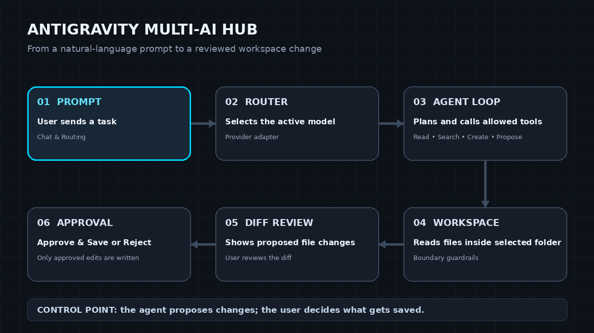
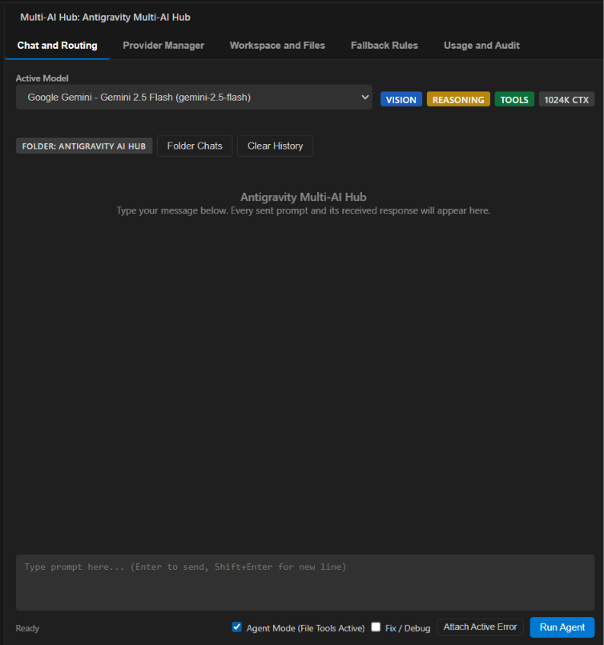
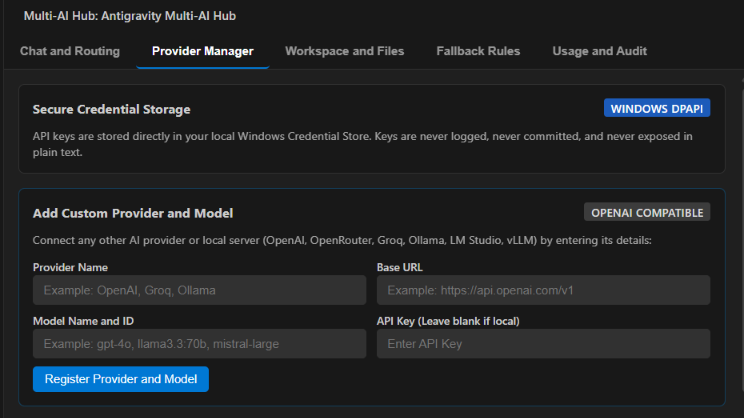
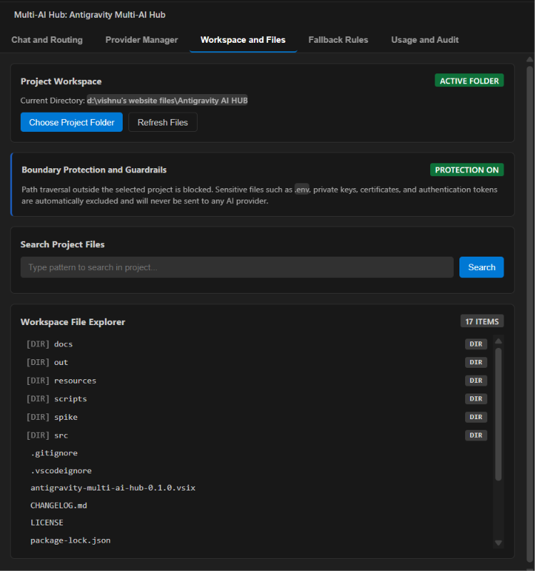
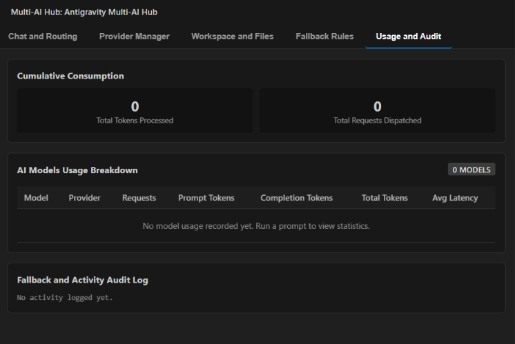

<div align="center">

# ⚡ Antigravity Multi-AI Hub

### A multi-provider AI coding companion for Google Antigravity

**One workspace. Multiple AI providers. Approval-first file changes.**

[](https://github.com/Guruvishnu444/AI-HUB-/releases)
[](LICENSE)
[](https://www.microsoft.com/windows)
[](https://www.typescriptlang.org/)

A companion extension that brings multiple AI providers into a dedicated panel beside your editor. Choose the model you want, connect it to a selected project workspace, and use an agent to inspect files and propose changes — with a human approval step before edits are written.

[Explore the Repository](https://github.com/Guruvishnu444/AI-HUB-) · [Report an Issue](https://github.com/Guruvishnu444/AI-HUB-/issues) · [View Changelog](CHANGELOG.md)

</div>

---

## ✨ What is Antigravity Multi-AI Hub?

Antigravity Multi-AI Hub is a VS Code-compatible extension designed to work alongside Google Antigravity IDE. It provides a separate multi-provider chat and coding-agent workspace, so you can select an AI model, ask questions about a project, and let the agent work with files inside a folder you explicitly choose.

The Hub is designed around three principles:

- **Model choice:** select the provider and model you want to use.
- **Workspace boundaries:** limit agent file access to the selected project folder and block sensitive files.
- **Human approval:** review proposed file changes before they are saved.

> **Independence notice:** This is an independent community project. It is not affiliated with, endorsed by, or sponsored by Google. It does not replace or modify Antigravity's built-in models, agents, or system files. The Hub operates as a separate panel beside the editor.

## 🎬 Agent and workspace workflow

The animation below illustrates the documented flow from a user prompt through routing, agent tools, workspace protection, diff review, and approval.

<p align="center">
  
</p>

**Workflow in plain language**

1. You enter a task in Chat and Routing.
2. The Hub sends the request to the selected provider through its adapter.
3. In Agent Mode, the agent loop can use the available workspace tools.
4. Workspace guardrails keep file operations inside the selected project folder and block known secret files.
5. Proposed edits are presented for review as a diff.
6. You choose **Approve and Save** or **Reject**. The agent does not directly run shell commands.

---

## 🧭 Application guide — page by page

The interface is organized into five main pages. Each page has a separate responsibility in the development workflow.

### 1. Chat and Routing — your AI command centre

<p align="center">
  
</p>

This is the main interaction area where you send prompts and work with your selected AI model.

**What you can do**

- **Active Model:** choose the provider/model for the current conversation.
- **Capability indicators:** view the model capability labels presented by the interface, such as Vision, Reasoning, Tools, and context size.
- **Folder Chats:** switch between project-folder conversations and restore their associated chat history.
- **Clear History:** clear the current chat history.
- **Prompt composer:** enter a task; press Enter to send or Shift+Enter to add a new line.
- **Agent Mode:** enable the file-aware agent workflow.
- **Fix / Debug:** use the interface's debugging-oriented option when working through an issue.
- **Attach Active Error:** include the active editor error context with your request.
- **Run Agent:** submit the prompt to the selected model/agent.

**Typical use cases**

- Ask questions about code in the selected project.
- Locate and understand existing implementation.
- Request a new file or a targeted code change.
- Ask for help debugging an error.
- Review agent-proposed changes before saving.

**Recommended workflow:** choose a model → select the correct folder → write a specific task → enable Agent Mode when file operations are needed → run the agent → inspect the diff.

### 2. Provider Manager — connect the models you use

<p align="center">
  
</p>

Provider Manager handles the AI services and model configurations available to the Hub.

**Provider support documented by the project**

| Provider | Integration |
|---|---|
| Google Gemini | Native Gemini API |
| DeepSeek | OpenAI-compatible API |
| OpenAI | OpenAI-compatible API |
| Anthropic Claude | Native provider adapter |
| OpenRouter | OpenAI-compatible API |
| Groq | OpenAI-compatible API |
| Custom providers | Custom OpenAI-compatible base URL and model ID |

**Provider management capabilities**

- Register a custom provider and model.
- Configure a provider base URL and model ID.
- Save or delete provider credentials.
- Test a provider connection.
- Discover available models where supported.
- Enable or disable individual models.
- Clean up unused providers and non-chat models.

**Credential handling**

The interface indicates Windows DPAPI-backed secure credential storage. The project documentation describes API keys as being stored through the editor's SecretStorage / operating-system credential store rather than in the Hub's ordinary state files or Git repository.

**Security reminder:** never paste an API key into a chat prompt, README, source file, screenshot, or public issue. Use the credential controls provided by the extension.

### 3. Workspace and Files — controlled project access

<p align="center">
  
</p>

This page connects the Hub to the project folder the agent is allowed to inspect and modify.

**Page sections**

| Section | Purpose |
|---|---|
| Project Workspace | Select the active project folder and refresh its file list. |
| Boundary Protection and Guardrails | Enforce the selected workspace boundary and sensitive-file restrictions. |
| Search Project Files | Search the selected project using a path or filename pattern. |
| Workspace File Explorer | Browse the folders and files detected inside the workspace. |

**How workspace access works**

1. Choose a project folder using **Choose Project Folder**.
2. Refresh the workspace file list when needed.
3. Search for a file or browse the file explorer.
4. Ask the agent to inspect or work with relevant files.
5. Review proposed changes before approving them.

**Boundary protection**

The project documentation describes protections against path traversal and symlinks/junctions that point outside the selected folder. Known credential and secret files are blocked from being read or sent to a provider. Other sensitive configuration files may require a warning and confirmation.

Examples of blocked file patterns documented by the project include `.env*`, private-key files, `.npmrc`, `.netrc`, `.pypirc`, Git credentials, cloud credentials, and service-account files.

> Workspace access is not unrestricted computer control. The documented agent tools focus on project-file operations, and the agent does not execute shell commands.

### 4. Fallback Rules — resilience when a provider fails

<p align="center">
  
</p>

The fallback engine helps a request continue when a provider encounters a supported temporary failure, rate limit, quota issue, or outage.

**Configuration explained**

- **Enable Automatic Fallback:** turn automatic provider switching on or off.
- **Priority Chain Order:** set the order in which configured providers should be attempted.
- **Max Immediate Retries:** configure how many retries are attempted for supported retryable failures.
- **Circuit Breaker Failure Threshold:** determine how many failures trigger a temporary provider skip.

**How fallback behaves**

1. A request is sent to the selected provider.
2. If a supported retryable failure occurs, the Hub can retry according to the configured policy.
3. If the provider continues failing, the circuit breaker can temporarily skip it.
4. The next eligible provider in the configured priority chain may be selected.
5. The Hub can trim conversation history to fit the target model's context window.

The project also documents protection for ambiguous network failures: when a connection drops after a request may already have been sent, the Hub asks whether to retry through a fallback provider or cancel, helping avoid unexpected duplicate requests.

**Important:** fallback depends on the providers you have configured and the type of error received. It does not guarantee that every failed request can be recovered.

### 5. Usage and Audit — understand activity and consumption

<p align="center">
  
</p>

This page gives visibility into model activity and fallback events.

**Dashboard areas**

- **Cumulative Consumption:** total tokens processed and total requests dispatched.
- **AI Models Usage Breakdown:** per-model request count, prompt tokens, completion tokens, total tokens, and average latency.
- **Fallback and Activity Audit Log:** activity records for requests, retries, provider fallbacks, credential changes, and errors.

The project documentation states that usage data is stored locally and retains the most recent 500 requests.

**Why this matters**

- Understand which configured models are being used.
- Compare request volume and estimated token consumption.
- Inspect latency trends.
- Review fallback and error activity while troubleshooting.

---

## 🧠 System architecture

The Hub separates the user interface, message routing, agent tools, workspace controls, provider adapters, and fallback logic.

```text
┌───────────────────────────────────────────────────────┐
│                 MULTI-AI HUB WEBVIEW                  │
│  Chat · Provider Manager · Workspace · Fallback ·     │
│  Usage & Audit                                         │
└──────────────────────────┬────────────────────────────┘
                           │ Extension messages
                           ▼
┌───────────────────────────────────────────────────────┐
│               MESSAGE GATEWAY / ROUTER                │
│             src/core/gateway/router.ts                │
└───────────────┬──────────────────────────┬────────────┘
                │                          │
                ▼                          ▼
┌─────────────────────────────┐  ┌──────────────────────┐
│       AGENT LOOP             │  │  FALLBACK ENGINE     │
│       Tool Executor          │  │  Retries             │
│                              │  │  Circuit Breaker     │
│  List / Read / Search        │  │  Context Trimmer     │
│  Active-file context         │  └──────────┬───────────┘
│  Create / Propose edits      │             │
└──────────────┬──────────────┘             │
               ▼                             ▼
┌─────────────────────────────┐  ┌──────────────────────┐
│       WORKSPACE LAYER        │  │  PROVIDER ADAPTERS   │
│  File Tree                   │  │  Gemini              │
│  Guardrails                  │  │  DeepSeek            │
│  Diff Engine                 │  │  Anthropic           │
│  Approval / Save             │  │  OpenAI-compatible   │
└─────────────────────────────┘  └──────────┬───────────┘
                                             │
                                             ▼
                                  ┌──────────────────────┐
                                  │  CONFIGURED AI API   │
                                  └──────────────────────┘
```

### Main architecture responsibilities

| Layer | Responsibility |
|---|---|
| Webview | Renders the five-page Hub interface and collects user actions. |
| Extension entry point | Registers the extension views and commands. |
| Gateway/router | Handles communication between the webview and extension logic. |
| Agent loop | Coordinates model-driven file tools and task steps. |
| Workspace layer | Provides file browsing, boundary checks, and proposed-change handling. |
| Provider adapters | Translate requests for supported provider APIs. |
| Fallback engine | Handles eligible retries, provider switching, circuit breaking, and context trimming. |
| Storage | Persists non-secret state and usage data; credentials use secure storage. |

---

## 📁 Project structure

The following is the repository structure documented by the project. Some implementation details may evolve as the codebase changes.

```text
AI-HUB-/
│
├── src/
│   ├── extension.ts
│   │
│   ├── core/
│   │   ├── adapters/
│   │   │   ├── Gemini adapter
│   │   │   ├── DeepSeek adapter
│   │   │   ├── Anthropic adapter
│   │   │   ├── OpenAI-compatible adapter
│   │   │   └── Provider registry
│   │   │
│   │   ├── agents/
│   │   │   ├── agentLoop
│   │   │   └── toolExecutor
│   │   │
│   │   ├── fallback/
│   │   │   ├── engine
│   │   │   ├── circuitBreaker
│   │   │   └── contextTrimmer
│   │   │
│   │   ├── gateway/
│   │   │   └── router
│   │   │
│   │   ├── storage/
│   │   │   ├── database
│   │   │   └── secretVault
│   │   │
│   │   └── types/
│   │       ├── chat
│   │       ├── errors
│   │       ├── ipc
│   │       ├── model
│   │       └── provider
│   │
│   ├── webview/
│   │   └── ui.ts
│   │
│   └── workspace/
│       ├── diffEngine
│       ├── fileTree
│       └── guardrails
│
├── scripts/
│   ├── build.js
│   ├── test_all.js
│   └── test_resilience.js
│
├── resources/
│   └── Extension icons and static resources
│
├── docs/
│   └── Architecture and compatibility documentation
│
├── spike/
│   └── Early compatibility prototype (not shipped)
│
├── CHANGELOG.md
├── LICENSE
├── package.json
├── package-lock.json
├── tsconfig.json
└── README.md
```

### How the main folders contribute

- **`src/core/adapters/`** — connects the Hub to external AI provider APIs.
- **`src/core/agents/`** — coordinates agent steps and executes the supported tool operations.
- **`src/core/fallback/`** — manages retry policy, circuit-breaker behavior, and context trimming.
- **`src/core/gateway/`** — routes messages between the UI and extension services.
- **`src/core/storage/`** — handles local application state and secure credential access.
- **`src/workspace/`** — protects workspace boundaries, builds file-tree information, and manages diffs.
- **`src/webview/`** — contains the panel UI.
- **`scripts/`** — contains build and test automation.
- **`resources/`** — contains extension assets such as the Activity Bar icon.
- **`docs/`** — holds project architecture and compatibility documentation.
- **`spike/`** — preserves the early compatibility prototype and is not part of the shipped runtime.

---

## 🛠️ Installation

### Requirements

| Requirement | Version / detail |
|---|---|
| Operating system | Windows 11 is the primary development and test platform |
| Editor | Google Antigravity IDE or a compatible VS Code extension host |
| Extension API compatibility | VS Code engine `^1.90.0` |
| Node.js | 18 or newer |
| Package manager | npm |
| AI access | API key for at least one supported provider |

Other operating systems may support the standard extension API, but they are not the primary tested environment.

### Option A — Install from a VSIX package

1. Obtain the `.vsix` package from the repository's Releases page or build it from source.
2. Open Antigravity.
3. Open the Extensions panel.
4. Select the Extensions panel's **...** menu.
5. Choose **Install from VSIX...**.
6. Select the downloaded package.
7. Reload the editor if prompted.

[Open project releases](https://github.com/Guruvishnu444/AI-HUB-/releases)

### Option B — Build from source

Clone the repository and install the locked dependencies:

```bash
git clone https://github.com/Guruvishnu444/AI-HUB-
cd AI-HUB-
npm ci
```

Build the VSIX package:

```bash
npm run build:vsix
```

The generated package is:

```text
antigravity-multi-ai-hub-0.1.0.vsix
```

Install that file using **Install from VSIX...** in the editor.

---

## 🚀 First-time setup

After installing the extension:

1. Open the **Multi-AI Hub** icon in the Activity Bar.
2. Open **Provider Manager**.
3. Register or select a provider.
4. Add the provider API key using the secure credential controls.
5. Use the connection test to verify the provider.
6. Discover models if the provider supports model discovery.
7. Open **Workspace and Files**.
8. Select the project folder the Hub should be allowed to access.
9. Return to **Chat and Routing**.
10. Choose the active model and send a prompt.
11. Enable Agent Mode when you want the agent to use workspace tools.
12. Inspect the proposed diff and approve or reject it.
13. Configure provider order and resilience behavior in **Fallback Rules**.
14. Review consumption and activity in **Usage and Audit**.

**First-run recommendation:** start with a non-sensitive test project and a provider you trust. Confirm the workspace boundary and diff approval behavior before using the Hub on important code.

---

## ⌨️ Command Palette

Open the editor Command Palette with `Ctrl + Shift + P`, then search for **Multi-AI Hub**.

| Command | Description |
|---|---|
| `Open Full Panel Beside Editor` | Opens the Hub as a full panel beside the code editor. |
| `Self-Diagnostic Health Check` | Checks whether the extension components are working. |
| `Select Project Workspace Folder` | Opens the project workspace folder selection flow. |

---

## 🧪 Development commands

Run these commands from the repository root.

| Command | Purpose |
|---|---|
| `npm ci` | Install dependencies from the lockfile. |
| `npm run compile` | Build the extension bundle. |
| `npm run watch` | Rebuild when source files change. |
| `npm run typecheck` | Run TypeScript type checking without emitting files. |
| `npm test` | Run the automated test suite. |
| `npm run build:vsix` | Package the extension into a VSIX file. |

### Suggested development sequence

```bash
npm ci
npm run typecheck
npm test
npm run compile
npm run build:vsix
```

If a command fails, inspect the error output before packaging or distributing the extension.

---

## 🔐 Security, privacy and responsible use

Security is a core part of the Hub's workspace workflow.

### Credential protection

- API keys are stored through the editor's secure SecretStorage mechanism / operating-system credential store.
- Keys are not intended to be written to ordinary Hub state files or committed to Git.
- Do not share keys in prompts, screenshots, source code, or public issue reports.

### Workspace boundaries

- File operations are scoped to the selected project workspace.
- Path traversal outside the selected folder is blocked.
- Symlinks and junctions that resolve outside the selected folder are denied.
- Known secret and credential files are blocked from agent reads and provider transmission.
- Other sensitive configuration files can require a warning and confirmation.

### Provider data flow

Prompts and file contents that the agent reads are sent to the provider selected for the request. Only connect providers you trust with the code and data in your workspace. Review the provider's privacy policy, retention terms, and pricing before use.

### Human-in-the-loop editing

The agent proposes changes; the user reviews them. File creation and edits are shown as diffs and are written only after approval. The documented agent does not run shell commands.

### Webview hardening

The project documentation describes a restrictive Content Security Policy, no remote scripts/styles/images, and escaping model output before rendering.

---

## ⚠️ Current scope and known limitations

- This is an early `0.1.0` release, primarily tested on Windows 11.
- The agent does not execute terminal or shell commands.
- Token counting and context trimming use an estimate rather than each provider's native tokenizer.
- The webview uses inline scripts, so the current Content Security Policy still permits inline scripts while blocking remote resources.
- Local model servers such as Ollama and LM Studio may expose compatible endpoints, but they are not yet documented as tested with this Hub.
- Provider fallback is limited to configured providers and supported error conditions.

Please report reproducible issues with the editor version, operating system, provider/model, and relevant sanitized logs. Never include API keys or private project data in an issue.

---

## 🤝 Contributing

Contributions, bug reports, and thoughtful feature suggestions are welcome.

### Contribution workflow

1. Fork the repository.
2. Create a focused branch for your change.
3. Keep provider-specific logic inside the adapter layer.
4. Keep workspace access checks inside the workspace/guardrail layer.
5. Avoid introducing secrets or personal project data into commits.
6. Run type checking and tests.
7. Build the extension and test the affected UI flow.
8. Open a pull request with a clear summary and test notes.

### Suggested branch names

```text
feature/provider-adapter
feature/workspace-search
fix/fallback-retry
fix/diff-review
docs/readme-update
```

### Pull request checklist

- [ ] The change has a clear, limited scope.
- [ ] No API keys, tokens, or private credentials are included.
- [ ] Workspace boundary behavior remains enforced.
- [ ] Proposed edits still require user approval.
- [ ] `npm run typecheck` passes.
- [ ] `npm test` passes.
- [ ] The extension builds successfully.
- [ ] Documentation is updated where needed.

---

## 🗺️ Roadmap ideas

The following are potential future directions, not promises or claims about currently implemented features:

- Expanded provider compatibility and integration tests.
- More detailed usage and fallback diagnostics.
- Improved workspace search and file navigation.
- Additional accessibility and keyboard-navigation improvements.
- More automated security and regression tests.
- Clearer setup guidance for supported local model servers.

---

## 📄 License

This project is released under the [MIT License](LICENSE).

---

## 👨‍💻 Author

**Guru Vishnu**  
Developer and creator of Antigravity Multi-AI Hub.

- GitHub: [@Guruvishnu444](https://github.com/Guruvishnu444)
- Repository: [AI-HUB-](https://github.com/Guruvishnu444/AI-HUB-)

---

<div align="center">

### Build with choice. Work with control.

**Antigravity Multi-AI Hub** — bring your preferred AI providers into one approval-first coding workspace.

⭐ If this project is useful, consider giving the repository a star.

</div>
