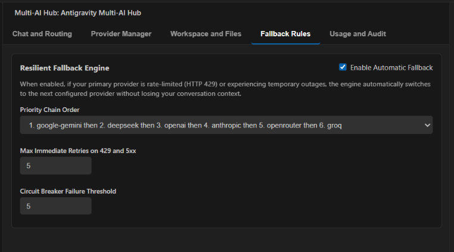

# ⚡ Antigravity Multi-AI Hub

### A multi-provider AI coding companion for Google Antigravity

**One workspace. Multiple AI providers. Approval-first file changes.**

[](https://github.com/Guruvishnu444/AI-HUB-/releases)
[](LICENSE)
[](https://www.microsoft.com/windows)
[](https://www.typescriptlang.org/)

A companion extension that brings multiple AI providers into a dedicated panel beside your editor. Choose the model you want, connect it to a selected project workspace, and use an agent to inspect files and propose changes — with a human approval step before edits are written.

[Explore the Repository](https://github.com/Guruvishnu444/AI-HUB-) · [Report an Issue](https://github.com/Guruvishnu444/AI-HUB-/issues) · [View Changelog](CHANGELOG.md)

---

## ✨ What is Antigravity Multi-AI Hub?

Antigravity Multi-AI Hub is a VS Code-compatible extension designed to work alongside Google Antigravity IDE. It provides a separate multi-provider chat and coding-agent workspace, so you can select an AI model, ask questions about a project, and let the agent work with files inside a folder you explicitly choose.

The Hub is designed around three principles:

- **Model choice:** select the provider and model you want to use.
- **Workspace boundaries:** limit agent file access to the selected project folder and block sensitive files.
- **Human approval:** review proposed file changes before they are saved.

> **Independence notice:** This is an independent community project. It is not affiliated with, endorsed by, or sponsored by Google. It does not replace or modify Antigravity's built-in models, agents, or system files. The Hub operates as a separate panel beside the editor.

## 🎬 Agent and workspace workflow

The animation below illustrates the documented flow from a user prompt through routing, agent tools, workspace protection, diff review, and approval.

<p align="center">
  
</p>

**Workflow in plain language**

1. You enter a task in Chat and Routing.
2. The Hub sends the request to the selected provider through its adapter.
3. In Agent Mode, the agent loop can use the available workspace tools.
4. Workspace guardrails keep file operations inside the selected project folder and block known secret files.
5. Proposed edits are presented for review as a diff.
6. You choose **Approve and Save** or **Reject**. The agent does not directly run shell commands.

---

## 🧭 Application guide — page by page

The interface is organized into five main pages. Each page has a separate responsibility in the development workflow.

### 1. Chat and Routing — your AI command centre

<p align="center">
  
</p>

This is the main interaction area where you send prompts and work with your selected AI model.

**What you can do**

- **Active Model:** choose the provider/model for the current conversation.
- **Capability indicators:** view the model capability labels presented by the interface, such as Vision, Reasoning, Tools, and context size.
- **Folder Chats:** switch between project-folder conversations and restore their associated chat history.
- **Clear History:** clear the current chat history.
- **Prompt composer:** enter a task; press Enter to send or Shift+Enter to add a new line.
- **Agent Mode:** enable the file-aware agent workflow.
- **Fix / Debug:** use the interface's debugging-oriented option when working through an issue.
- **Attach Active Error:** include the active editor error context with your request.
- **Run Agent:** submit the prompt to the selected model/agent.

**Typical use cases**

- Ask questions about code in the selected project.
- Locate and understand existing implementation.
- Request a new file or a targeted code change.
- Ask for help debugging an error.
- Review agent-proposed changes before saving.

**Recommended workflow:** choose a model → select the correct folder → write a specific task → enable Agent Mode when file operations are needed → run the agent → inspect the diff.

### 2. Provider Manager — connect the models you use

<p align="center">
  
</p>

Provider Manager handles the AI services and model configurations available to the Hub.

**Provider support documented by the project**

| Provider | Integration |
|---|---|
| Google Gemini | Native Gemini API |
| DeepSeek | OpenAI-compatible API |
| OpenAI | OpenAI-compatible API |
| Anthropic Claude | Native provider adapter |
| OpenRouter | OpenAI-compatible API |
| Groq | OpenAI-compatible API |
| Custom providers | Custom OpenAI-compatible base URL and model ID |

**Provider management capabilities**

- Register a custom provider and model.
- Configure a provider base URL and model ID.
- Save or delete provider credentials.
- Test a provider connection.
- Discover available models where supported.
- Enable or disable individual models.
- Clean up unused providers and non-chat models.

**Credential handling**

The interface indicates Windows DPAPI-backed secure credential storage. The project documentation describes API keys as being stored through the editor's SecretStorage / operating-system credential store rather than in the Hub's ordinary state files or Git repository.

**Security reminder:** never paste an API key into a chat prompt, README, source file, screenshot, or public issue. Use the credential controls provided by the extension.

### 3. Workspace and Files — controlled project access

<p align="center">
  
</p>

This page connects the Hub to the project folder the agent is allowed to inspect and modify.

**Page sections**

| Section | Purpose |
|---|---|
| Project Workspace | Select the active project folder and refresh its file list. |
| Boundary Protection and Guardrails | Enforce the selected workspace boundary and sensitive-file restrictions. |
| Search Project Files | Search the selected project using a path or filename pattern. |
| Workspace File Explorer | Browse the folders and files detected inside the workspace. |

**How workspace access works**

1. Choose a project folder using **Choose Project Folder**.
2. Refresh the workspace file list when needed.
3. Search for a file or browse the file explorer.
4. Ask the agent to inspect or work with relevant files.
5. Review proposed changes before approving them.

**Boundary protection**

The project documentation describes protections against path traversal and symlinks/junctions that point outside the selected folder. Known credential and secret files are blocked from being read or sent to a provider. Other sensitive configuration files may require a warning and confirmation.

Examples of blocked file patterns documented by the project include `.env*`, private-key files, `.npmrc`, `.netrc`, `.pypirc`, Git credentials, cloud credentials, and service‑account files.

> Workspace access is not unrestricted computer control. The documented agent tools focus on project-file operations, and the agent does not execute shell commands.

### 4. Fallback Rules — resilience when a provider fails

<p align="center">
  
</p>

The fallback engine helps a request continue when a provider encounters a supported temporary failure, rate limit, quota issue, or outage.

**Configuration explained**

- **Enable Automatic Fallback:** turn automatic provider switching on or off.
- **Priority Chain Order:** set the order in which configured providers should be attempted.
- **Max Immediate Retries:** configure how many retries are attempted for supported retryable failures.
- **Circuit Breaker Failure Threshold:** determine how many failures trigger a temporary provider skip.

**How fallback behaves**

1. A request is sent to the selected provider.
2. If a supported retryable failure occurs, the Hub can retry according to the configured policy.
3. If the provider continues failing, the circuit breaker can temporarily skip it.
4. The next eligible provider in the configured priority chain may be selected.
5. The Hub can trim conversation history to fit the target model's context window.

The project also documents protection for ambiguous network failures: when a connection drops after a request may already have been sent, the Hub asks whether to retry through a fallback provider or cancel, helping avoid unexpected duplicate requests.

**Important:** fallback depends on the providers you have configured and the type of error received. It does not guarantee that every failed request can be recovered.

### 5. Usage and Audit — understand activity and consumption

<p align="center">
  
</p>

This page gives visibility into model activity and fallback events.

**Dashboard areas**

- **Cumulative Consumption:** total tokens processed and total requests dispatched.
- **AI Models Usage Breakdown:** per-model request count, prompt tokens, completion tokens, total tokens, and average latency.
- **Fallback and Activity Audit Log:** activity records for requests, retries, provider fallsbacks, credential changes, and errors.

The project documentation states that usage data is stored locally and retains the most recent 500 requests.

**Why this matters**

- Understanding token usage helps control costs.
- Audit logs provide traceability for changes made by the agent.
- Fallback visibility helps diagnose provider reliability issues.

---

## Project structure

```
.
├── src/
│   ├── extension.ts            # Entry point: registers views and commands
│   ├── core/
│   │   ├── adapters/           # gemini, deepseek, anthropic, openaiCompatible, registry
│   │   ├── agents/             # agentLoop, toolExecutor
│   │   ├── fallback/           # engine, circuitBreaker, contextTrimmer
│   │   ├── gateway/            # router (webview <-> extension messages)
│   │   ├── storage/            # database (JSON state), secretVault (API keys)
│   │   └── types/              # chat, errors, ipc, model, provider
│   ├── webview/ui.ts           # The panel's HTML, CSS, and client script
│   └── workspace/              # diffEngine, fileTree, guardrails
├── scripts/                    # build.js, test_all.js, test_resilience.js
├── docs/                       # Compatibility report and architecture
├── resources/                  # Activity Bar icon
├── spike/                      # Phase 1 compatibility prototype (not shipped)
├── PROJECT_BRIEF.md            # Original project requirements
├── CHANGELOG.md
└── LICENSE
```

---

## Development

| Command | Purpose |
| :--- | :--- |
| `npm ci` | Install dependencies |
| `npm run compile` | Bundle the extension to `out/extension.js` |
| `npm run watch` | Rebuild on every change |
| `npm run typecheck` | Type‑check with `tsc --noEmit` |
| `npm test` | Run the automated test suite |
| `npm run build:vsix` | Package the extension as a `.vsix` |

---

## Data and privacy

- Your prompts, and any file contents you attach or the agent reads, are sent to the provider you selected. Use only providers you trust with that code.
- The extension contacts only the provider endpoints you configure (and opens links in your browser when you click them). It contains no telemetry or analytics code.
- You are responsible for each provider's terms of service and for any API charges.

---

## Known limitations

- Early release (v0.1.0), tested mainly on Windows 11.
- The agent cannot run terminal commands.
- Token counts and context trimming use an estimate, not each provider's real tokenizer.
- The panel's scripts are inline, so the Content‑Security‑Policy still allows inline scripts. It blocks all remote resources.
- Local model servers (Ollama, LM Studio) are untested.

---
